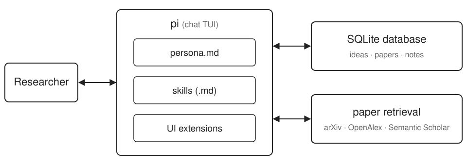
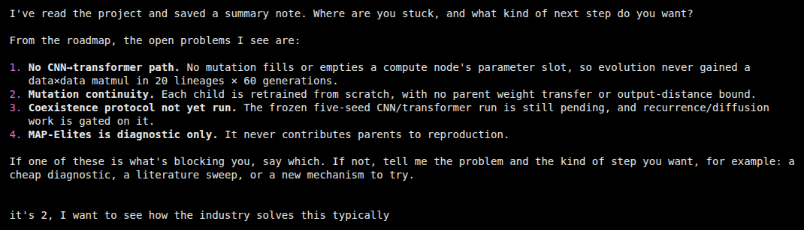
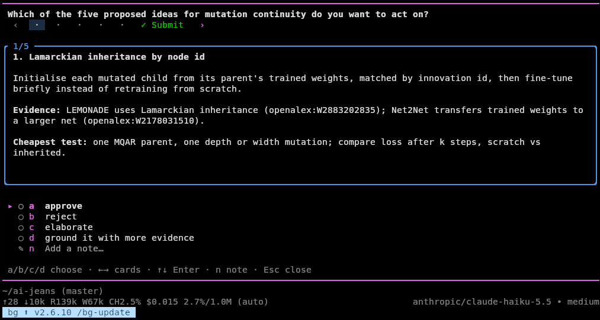

# J.A.R.V.I.S.

**Just-in-time Agent for Research Validation & Ideation Support**

2026-10-27

---

## The problem

- A researcher can have blind spots.
- It's easy to get stuck on a hard problem, and advisors can not be available at all times.

---

## What J.A.R.V.I.S. does

It's a chat agent, like claude code. 
Interface is built atop pi (minimal TUI coding assistant). Our work is composed of persona.md, .md skills, a sqlite database, ui extensions, and backend work for paper source retrieval. 
Paper sources: arxiv, openalex, and semantic scholar.

---

## Demo

---

## Demo

---

## Preliminary results

- Because it's in idea-realm, I'm not concerned with accuracy moreso than breadth.
- The results, subjectively, have breadth as well as relevance. 

---

## Why it is creative

- Novelty: Dedup means that ideas progressively move on from what's already been seen.
- Ranking: Ideas are ranked by subective next-step promise in an Elo system.

---

## Deduplication

- Candidate new ideas are generated.
- Simple embeddings compare similarity to others in the database, rejecting too-similar new ideas.

We'll consider more sophisticated final judgements of uniqueness in another pass.

---

## Challenges

- addressed in previous slides

---

## Work remaining

- Deeper eval of deduplication and ranking.
